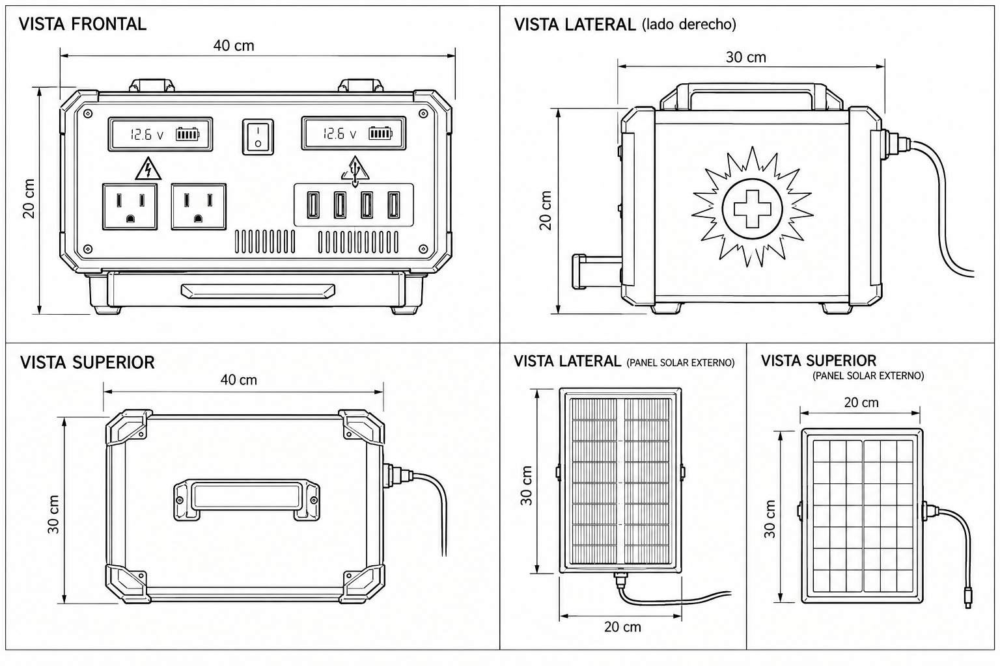
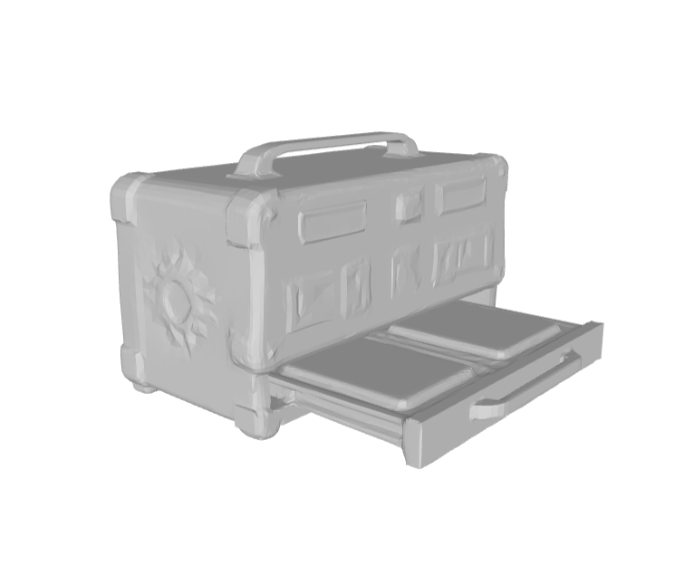

# SolarSaver-SS ☀️🔋
### Estación Solar Portátil de Emergencia — Experiencia Interactiva 3D y Realidad Mixta (WebXR)

[](#)
[](https://threejs.org/)
[](#)
[](#)

**SolarSaver-SS** es una aplicación web 3D interactiva y de Realidad Mixta (Mixed Reality / WebXR) desarrollada desde cero con **Three.js** y **Vite**, basada fielmente en los planos técnicos oficiales y en el modelo 3D STL del prototipo de cargador solar portátil para situaciones de rescate y emergencias.

---

## 📸 Referencias de Diseño e Ingeniería

El modelo tridimensional y la simulación están construidos a escala métrica real (1 unidad = 1 metro) respetando cada detalle del diseño de referencia:

| Plano Técnico Oficial (Cotas y Vistas) | Prototipo STL Tridimensional |
| :---: | :---: |
|  |  |
| *Vistas Frontal, Lateral, Superior y Panel Solar Externo* | *Bandeja frontal extraída con dos teléfonos celulares* |

---

## 📐 Características Físicas del Prototipo

* **Dimensiones de la Estación:** 40 cm de ancho × 20 cm de alto × 30 cm de profundidad.
* **Carcasa de Alto Impacto:** Polímero ABS táctico con 8 esquineros reforzados (bumpers de absorción de impacto con tornillería empotrada).
* **Panel Frontal Ergonómico:**
  * **Dos Pantallas LCD Retroiluminadas en Azul:**
    * *Display Izquierdo (Entrada Solar / MPPT):* Muestra voltaje nominal dinámico (`12.6 v`), gráfica de 5 barras de batería `[|||||]`, irradiancia en $W/m^2$ y flujo neto de corriente.
    * *Display Derecho (Salidas / Cargas):* Muestra voltaje de salida, estado de tomas de 120V CA, puertos USB y temperatura operativa.
  * **Interruptor Maestro Basculante (Rocker Switch):** Con serigrafía `I / O`, inclinación física animada y LED indicador de estado verde/rojo.
  * **Dos Tomas de Corriente CA (120V):** Con señalética reglamentaria de peligro por alta tensión (triángulo amarillo con rayo).
  * **Cuatro Puertos USB-A 5V:** Con insertos azules y simbología grabada.
  * **Rejillas de Ventilación:** 9 ranuras bajo tomas de CA y 14 ranuras bajo puertos USB, con ventilador interno de refrigeración asistida visible en giro.
* **Bandeja Extraíble Inferior:**
  * Ubicada en la parte frontal inferior con manija de tracción.
  * Corredera suave animada que se abre al frente.
  * Bahía interna doble diseñada para alojar simultáneamente dos teléfonos inteligentes.
* **Logotipo Lateral:** Emblema en relieve del sol con rayos radiales y cruz médica de rescate en su interior.
* **Panel Solar Externo Independiente:**
  * Dimensiones: 30 cm de alto × 20 cm de ancho × 2.2 cm de espesor.
  * Celdas fotovoltaicas monocristalinas de alta eficiencia con barras conductoras de plata.
  * Marco perimetral de aluminio con soporte basculante e inclinación graduable.
  * Conectado a la estación mediante un cable flexible de goma de alta resistencia que se ajusta proceduralmente en 3D según la posición del panel.

---

## 🎮 Funcionalidades Interactivas Desarrolladas

1. **Exploración 3D Libre y Guiada:**
   * Rotación orbital de 360°, paneo y zoom suave mediante ratón o gestos táctiles.
   * Botones de vista preestablecida con transiciones de cámara cinematográficas:
     * *Vista Frontal* (pantallas, tomas 120V, USB e interruptor).
     * *Vista Lateral* (emblema Sol + Cruz y conexión del cable).
     * *Vista Superior* (manija central y refuerzos).
     * *Vista Isométrica 3D* (perspectiva general de rescate).
     * *Bandeja de Celulares* (primer plano de la corredera y los dos teléfonos).
     * *Panel Solar* (orientación fotovoltaica).
2. **Encendido y Apagado Virtual:**
   * Al accionar el interruptor o el botón de la interfaz, el switch bascula en 3D, el LED de estado cambia y las pantallas LCD se iluminan en azul brillante o pasan al modo apagado con sonido mecánico de alta fidelidad.
3. **Bandeja Deslizante, Celulares Virtuales y Control de Carga:**
   * Apertura y cierre animado de la bandeja inferior con efecto sonoro de fricción.
   * Posibilidad de colocar o retirar individualmente el **Celular A** y el **Celular B**.
   * **Selectores de Porcentaje de Batería:** Deslizadores interactivos y botones de ajuste rápido (10%, 50%, 85%, 100%) para modificar libremente el nivel de carga actual de cada celular o de la estación.
4. **Simulación de Carga Acelerada en Tiempo Real:**
   * **Multiplicador de Tiempo Real (1×, 5×, 20×, 60×, 120×):** Permite ver en cuestión de segundos el proceso completo de carga y descarga de los teléfonos y del banco de baterías de la estación.
   * **Ciclo Solar Continuo:** Modo opcional para observar el desplazamiento continuo del Sol por el cielo con variación dinámica de sombras e iluminación.
5. **Entorno Exterior Vívido con Casa 3D:**
   * Representación en 3D de una casa residencial/refugio en la parte trasera con porche de madera, ventanas iluminadas, paneles solares en el tejado, chimenea y cerco.
   * Iluminación diurna brillante, cúpula celeste procedural con degradados realistas, césped natural con textura y terraza de piedra.
5. **Panel Solar Orientable & Auto-Tracking:**
   * Deslizadores interactivos de inclinación (10° a 85°) y azimut (0° a 360°).
   * Botón de **"Alinear Panel con el Sol"** que calcula automáticamente el vector de incidencia óptimo reduciendo las pérdidas por desalineación.
6. **Simulación de Ciclo Solar y Clima:**
   * Deslizador de hora del día (6:00 a 18:00) que mueve el Sol 3D por la bóveda celeste modificando las sombras, temperatura de color y nivel de irradiancia.
   * Deslizador de nubosidad atmosférica que simula atenuación por cielo cubierto.
   * Cálculo matemático de potencia solar según la ley del coseno de Lambert:
     $$P = P_{\text{max}} \cdot \max(0, \vec{N}_{\text{panel}} \cdot \vec{S}_{\text{sol}}) \cdot (1 - \text{Nubosidad})$$
7. **Telemetría y Gestión de Batería en Tiempo Real (HUD):**
   * Curva no lineal de voltaje de batería Li-ion 3S (10.8V a 12.6V).
   * Cálculo del balance neto en Watts (+ cargando / − descargando).
   * Estimador automático de tiempo de recarga completa o autonomía restante.
   * Simulación térmica y activación del ventilador con cargas elevadas.
8. **Interacción Directa con Raycasting y Tooltips:**
   * Al pasar el cursor sobre cualquier componente 3D (interruptor, pantallas, bandeja, celulares, panel solar), se muestra un tooltip explicativo y el cursor cambia a puntero para interactuar con un clic directo.
9. **Modo Realidad Virtual (VR) para Gafas META Quest:**
   * **Botón Conmutador Dual:** Permite alternar instantáneamente entre `🎮 Vista Normal de Juego (Orbit)` y `🥽 Modo VR (Meta Quest)`.
   * **Compatibilidad Nativa WebXR en Meta Quest:** Al abrir el proyecto en el navegador oficial *Meta Quest Browser* (en Quest 2, Quest 3, Quest 3S o Quest Pro), se inicia una sesión inmersiva WebXR a escala humana 1:1 en el patio frente a la mesa de trabajo y la casa.
   * **Mandos Táctiles con Puntero Láser y Háptica:** Rayos láser interactivos proyectados desde los controladores Meta Quest Touch para apuntar y accionar el interruptor, la bandeja, los teléfonos y el panel solar con vibración háptica en el gatillo.
   * **Tablet 3D Flotante con Telemetría en VR:** Pantalla holográfica tridimensional situada en el entorno virtual que muestra voltaje, potencia solar y estado de carga sin tener que quitarse el visor.
   * **Simulador de Vista VR en Navegador Convencional:** Si se activa el modo VR en una pantalla de escritorio o móvil sin visor conectado, la cámara desciende a altura de ojos humana (1.65 m) en primera persona con retícula central interactiva.
10. **Visor de Documentación y Planos Técnicos:**
    * Modal interactivo integrado con el plano técnico original de cotas, render STL tridimensional, tabla de especificaciones completas y lecciones didácticas sobre energía solar.
11. **Efectos de Audio Procedurales (Web Audio API):**
    * Síntesis sonora en tiempo real de clics mecánicos, deslizamiento de corredera, avisos de conexión de celulares y zumbido suave de inversor a 60 Hz sin dependencias externas de archivos MP3.

---

## 🛠️ Tecnologías Utilizadas

* **Three.js (v0.186):** Motor gráfico 3D WebGL para renderizado de mallas, texturas procedurales CanvasTexture, iluminación fotométrica con sombras suaves y WebXR.
* **Vite (v8):** Empaquetador ultrarrápido y servidor de desarrollo.
* **Vitest:** Suite de pruebas unitarias automatizadas para los modelos matemáticos y simulaciones físicas.
* **HTML5 Canvas 2D API:** Generación en tiempo real a 60 FPS de las pantallas LCD, diales digitales, etiquetas de peligro de 120V e interfaces de los smartphones.
* **Web Audio API:** Síntesis sonora procedural libre de assets pesados.
* **CSS3 Glassmorphism:** Interfaz moderna estilo panel de control de brigada de rescate.

---

## 🚀 Instrucciones de Instalación y Ejecución Local

### Prerrequisitos
* Node.js v18 o superior instalado en el equipo.
* Gestor de paquetes `npm` (incluido con Node.js).

### Pasos para Ejecutar

1. **Clonar el repositorio:**
   ```bash
   git clone https://github.com/migulopez/SolarSaver-SS-.git
   cd SolarSaver-SS-
   ```

2. **Instalar dependencias:**
   ```bash
   npm install
   ```

3. **Ejecutar el servidor de desarrollo:**
   ```bash
   npm run dev
   ```
   Abre en tu navegador la URL indicada en la consola (por defecto: `http://localhost:5173/`).

4. **Ejecutar las pruebas unitarias:**
   ```bash
   npm test
   ```

5. **Compilar para producción:**
   ```bash
   npm run build
   ```
   Los archivos estáticos optimizados quedarán generados en la carpeta `dist/`.

6. **Previsualizar la compilación de producción:**
   ```bash
   npm run preview
   ```

---

## 🌐 Despliegue en GitHub Pages

El proyecto incluye un flujo automatizado de integración continua mediante GitHub Actions en `.github/workflows/deploy.yml`.

### Activación en el repositorio:
1. En GitHub, dirígete a la pestaña **Settings** del repositorio `SolarSaver-SS-`.
2. En la barra lateral izquierda, selecciona **Pages**.
3. En la sección **Build and deployment > Source**, elige **GitHub Actions**.
4. Cada vez que se realice un commit en la rama principal o de producción, el flujo compilará la aplicación y la publicará automáticamente en:
   **`https://migulopez.github.io/SolarSaver-SS-/`**

---

## 📂 Estructura del Proyecto

```text
SolarSaver-SS-/
├── .github/
│   └── workflows/
│       └── deploy.yml            # Pipeline CI/CD para despliegue en GitHub Pages
├── public/
│   └── assets/
│       ├── favicon.svg           # Isotipo del Sol y Cruz de emergencia
│       ├── plano_tecnico_solarsaver.png   # Plano técnico acotado original
│       └── render_stl_solarsaver.png      # Render 3D del prototipo con bandeja
├── src/
│   ├── audio/
│   │   └── SoundManager.js       # Síntesis procedural de audio Web Audio API
│   ├── models/
│   │   ├── StationModel.js       # Modelo 3D de la estación (40×20×30 cm)
│   │   ├── SolarPanelModel.js    # Modelo 3D del panel externo (30×20 cm)
│   │   ├── SmartphoneModel.js    # Modelo 3D de los teléfonos con pantalla viva
│   │   ├── CableModel.js         # Cable flexible 3D procedural con catenaria
│   │   └── TextureFactory.js     # Texturas dinámicas (LCDs, decals 120V, celdas)
│   ├── scene/
│   │   ├── SceneManager.js       # Orquestador Three.js, cámara y WebXR
│   │   ├── EnvironmentManager.js # Iluminación solar, sombras y bóveda celeste
│   │   └── InteractionManager.js # Raycasting de clics y tooltips interactivos
│   ├── simulation/
│   │   ├── PowerSimulator.js     # Simulación de batería Li-ion 3S y cargas
│   │   └── SolarCalculator.js    # Ley del coseno, posición solar e irradiancia
│   ├── ui/
│   │   ├── ControlsOverlay.js    # Panel interactivo de hardware y clima
│   │   ├── TelemetryHUD.js       # Pantalla de métricas en tiempo real
│   │   └── TechnicalModal.js     # Modal de planos técnicos y especificaciones
│   ├── main.js                   # Punto de entrada principal
│   └── style.css                 # Estilos tácticos oscuros y responsivos
├── tests/
│   ├── simulator.test.js         # Pruebas del cálculo solar y batería
│   └── thermal_and_loads.test.js # Pruebas de cargas AC/USB y refrigeración
├── index.html                    # Documento HTML principal
├── package.json                  # Dependencias y scripts
├── vite.config.js                # Configuración de compilación con base relativa
└── README.md                     # Documentación completa del proyecto
```

---

## 📄 Licencia

Este proyecto está distribuido bajo la Licencia MIT.
Desarrollado para la estación solar portátil de emergencias **SolarSaver-SS**.
